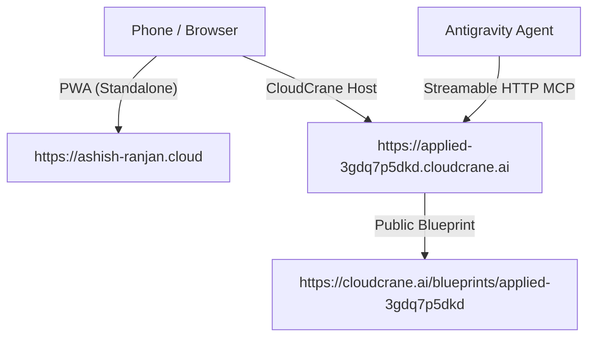

# Applied — Job Application Tracker 📱

[](https://cloudcrane.ai/blueprints/applied-3gdq7p5dkd)
[](https://ashish-ranjan.cloud)
[](https://ashish-ranjan.cloud)

A mobile-first, offline-ready Progressive Web App (PWA) built for the **CloudCrane First-Round Challenge**.

* **Live Custom Domain:** [https://ashish-ranjan.cloud](https://ashish-ranjan.cloud)
* **Live CloudCrane Blueprint:** [https://cloudcrane.ai/blueprints/applied-3gdq7p5dkd](https://cloudcrane.ai/blueprints/applied-3gdq7p5dkd)
* **CloudCrane Host:** [https://applied-3gdq7p5dkd.cloudcrane.ai/](https://applied-3gdq7p5dkd.cloudcrane.ai/)

---

## 🎯 What it Does & Why

**Applied** is a personal job application tracker tailored for phone home screens. When actively applying and interviewing, keeping tabs on stages, conversations, dates, and notes without SaaS bloat or accounts is critical.

* **100% Offline & Private:** Stored on the user's phone via `localStorage`. What you save never leaves your device.
* **Instant Touch Interaction:** Designed to feel like a native app (touch targets ≥ 48px, haptic vibration, safe-area-insets, 100dvh).
* **Installable:** PWA manifest with standalone display mode and offline service worker caching.

---

## 🔄 Version Evolution (Shipped Iterations)

| Version | Description | CloudCrane Quality Score |
| :--- | :--- | :---: |
| **v1 (MVP)** | Initial pipeline dashboard, 4 stage counters, category filter tabs, job cards, bottom sheet modal. | **85 / 100** |
| **v2 (Schema Migration)** | **Data schema v1 → v2 migration**: Added interactive **Stage History Timeline** without losing existing saved records. 48px touch targets and enhanced contrast. | **99 / 100** |
| **Rollback** | Tested `rollback_app` to v2; verified data compatibility protection. | — |
| **v3 & v4 (Polish & Search)** | **Data schema v2 → v3**: Real-time search across company/role/tags, tag filter chips, **Interview Conversion Rate** analytics banner, 1-tap JSON data export, and 16px iOS font scaling. | 🏆 **100 / 100** |

---

## 🏗️ Architecture



---

## 📂 Repository Structure

```
├── apps/
│   ├── v1/app.html          # Version 1 MVP source
│   ├── v2/app.html          # Version 2 with Status History Timeline
│   └── v3/app.html          # Version 3/4 with Search, Tags, Export
├── src/
│   ├── auth/oauth.py        # CloudCrane OAuth 2.0 PKCE helper
│   └── cloudcrane/client.py # Streamable HTTP MCP JSON-RPC Client
├── tests/
│   └── test_live_app.py     # 29-step headless Chrome E2E test suite
├── .token.example.json      # Example OAuth token format
├── requirements.txt         # Dependencies (Selenium, requests, pkce, etc.)
└── README.md
```

---

## 🚀 Local Setup & Testing

### 1. Environment Setup
```bash
git clone https://github.com/ashish-ranjan-jobs/cloudcrane-app.git
cd cloudcrane-app
python3 -m venv venv
source venv/bin/activate
pip install -r requirements.txt
```

### 2. Run the 29-Step E2E Test Suite
Runs in headless Chrome testing all 29 user journeys, filters, local storage persistence, modals, and PWA assets:
```bash
python3 tests/test_live_app.py
```

### 3. Connect to CloudCrane MCP
```bash
# Generate OAuth authorize URL
python3 src/auth/oauth.py

# Exchange authorization code for token
python3 src/auth/oauth.py exchange "<callback_url_with_code>"
```

---

## 📄 License
MIT
