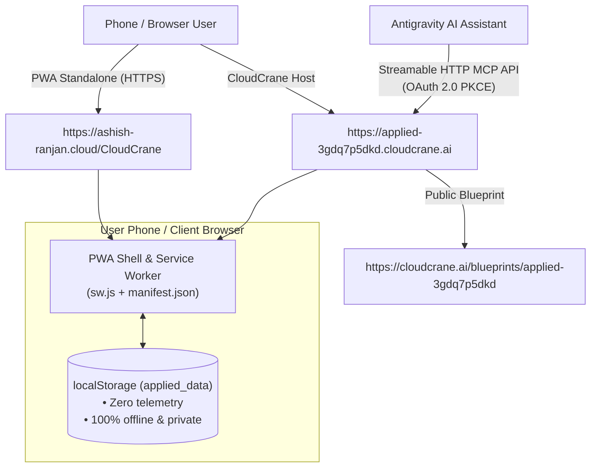

# Applied — Job Application Tracker 📱

[](https://cloudcrane.ai/blueprints/applied-3gdq7p5dkd)
[](https://ashish-ranjan.cloud/CloudCrane)
[](https://ashish-ranjan.cloud/CloudCrane)
[](LICENSE)

A mobile-first, offline-ready Progressive Web App (PWA) built for the **CloudCrane First-Round Challenge**.

* **Live Custom Domain PWA:** [https://ashish-ranjan.cloud/CloudCrane](https://ashish-ranjan.cloud/CloudCrane)
* **Live CloudCrane Blueprint:** [https://cloudcrane.ai/blueprints/applied-3gdq7p5dkd](https://cloudcrane.ai/blueprints/applied-3gdq7p5dkd)
* **CloudCrane Host:** [https://applied-3gdq7p5dkd.cloudcrane.ai/](https://applied-3gdq7p5dkd.cloudcrane.ai/)
* **Public GitHub Repo:** [https://github.com/ashish-ranjan-jobs/cloudcrane-app](https://github.com/ashish-ranjan-jobs/cloudcrane-app)

---

## 📱 Live Demo: How It Exactly Works

When you visit [https://ashish-ranjan.cloud/CloudCrane](https://ashish-ranjan.cloud/CloudCrane) on your phone or desktop browser, the app loads **instantaneously** with a pre-seeded, realistic demo pipeline.

### Visual Walkthrough of the Mobile Interface

```text
┌──────────────────────────────────────────────┐
│  (A) Applied         [⚡ Demo]  [⤓]  [+ Add]  │  <-- Header & 1-tap Demo reset
├──────────────────────────────────────────────┤
│  🔍 Search company, role, or tags...         │  <-- Real-time regex & tag search
├──────────────────────────────────────────────┤
│  🎯 Interview Conversion: 75%                │  <-- Dynamic conversion analytics
│     3 of 4 applications advanced             │
├──────────────────────────────────────────────┤
│  [ 4 Total ] [ 1 Applied ] [ 2 Interview ]   │  <-- Pipeline Stage Counters
│  [ 1 Offer ] [ 0 Rejected ]                  │
├──────────────────────────────────────────────┤
│  [ All (4) ] [ Applied ] [ Interview ] ...   │  <-- Stage Filter Tabs
├──────────────────────────────────────────────┤
│ ┌──────────────────────────────────────────┐ │
│ │ CloudCrane                 [ interview ] │ │  <-- Job Card with tags & metadata
│ │ Full Stack Engineer • $165,000 / yr      │ │
│ │ #Remote  #AI  #Cloud  #TypeScript        │ │
│ │ Applied: Nov 12, 2026 • 2 stage entries  │ │
│ └──────────────────────────────────────────┘ │
│ ┌──────────────────────────────────────────┐ │
│ │ Stripe                         [ offer ] │ │
│ │ Staff Infra Engineer • $210,000 / yr     │ │
│ │ #Fintech  #DistributedSystems  #Go       │ │
│ │ Applied: Nov 05, 2026 • 3 stage entries  │ │
│ └──────────────────────────────────────────┘ │
│ ┌──────────────────────────────────────────┐ │
│ │ Anthropic                  [ interview ] │ │
│ │ AI Research Engineer • $195,000 / yr     │ │
│ │ #LLM  #Python  #Evaluation  #MCP         │ │
│ │ Applied: Nov 09, 2026 • 2 stage entries  │ │
│ └──────────────────────────────────────────┘ │
│ ┌──────────────────────────────────────────┐ │
│ │ Linear                       [ applied ] │ │
│ │ Senior Product Engineer • $170,000 / yr  │ │
│ │ #Frontend  #TypeScript  #Design          │ │
│ │ Applied: Nov 15, 2026 • 1 stage entry    │ │
│ └──────────────────────────────────────────┘ │
└──────────────────────────────────────────────┘
```

---

### Step-by-Step Feature Walkthrough

#### 1. Instant First-Visit Demo Data
* On first load, **Applied** auto-populates four realistic technology roles (**CloudCrane**, **Stripe**, **Anthropic**, and **Linear**).
* Each job card includes target compensation, skill tags, application date, current stage, and stage history entries.
* You can test features immediately without manually filling out forms.

#### 2. Interactive Demo Controls (`⚡ Demo` & Empty State Loader)
* **Header Button:** Tap `⚡ Demo` at any time to re-seed the sample dataset with one tap.
* **Empty State:** If you delete all applications or search for a non-existent query, an empty state is rendered with a `⚡ Load Sample Pipeline` button to quickly restore demo records.

#### 3. Real-Time Conversion Analytics
* The top card dynamically calculates your **Interview Conversion Rate**:
  $$\text{Conversion Rate} = \frac{\text{Interview} + \text{Offer}}{\text{Total Applications}} \times 100\%$$
* In the demo dataset: $\frac{2 \text{ Interview} + 1 \text{ Offer}}{4 \text{ Total}} = \mathbf{75\%}$.
* Adding, updating, or deleting applications instantly recalculates this metric in real time.

#### 4. Logging a New Application (`+ Add`)
* Tap **`+ Add`** in the top navigation.
* A smooth mobile bottom sheet animates into view with:
  - **Company Name** (e.g., `OpenAI`)
  - **Position / Role** (e.g., `Systems Engineer`)
  - **Tags** (comma-separated, e.g., `Rust, Distributed, Remote`)
  - **Date Applied** (defaults to today's date)
  - **Initial Stage** (`applied`, `interview`, `offer`, `rejected`)
  - **Target Salary** (e.g., `$190,000`)
* Form inputs use a minimum `16px` font size to completely eliminate unwanted auto-zoom on iOS Safari.
* Submitting vibrates with a subtle 25ms haptic confirmation and updates the pipeline immediately.

#### 5. Stage History Timeline & Stage Progression
* Tap any job card (e.g., **CloudCrane**) to open its detail sheet.
* View the chronological **Stage History Timeline**:
  ```text
  ● [interview] Nov 14, 2026
    "Shortlisted for first round app building challenge."
  │
  ● [applied] Nov 12, 2026
    "Applied through careers portal with portfolio & GitHub."
  ```
* Change the stage (e.g., promote to **Offer**), type an optional transition note (e.g., *"Passed final round demo"*), and tap **Update Stage**.
* A new milestone is prepended to the timeline, and the dashboard counters recalculate.

#### 6. Live Search & Tag Filtering
* **Instant Substring & Tag Search:** Type `#Remote`, `Stripe`, or `Full Stack` in the search bar. The list filters instantly without debouncing lag.
* **Stage Tabs:** Tap **Interview**, **Offer**, or **Applied** filter pills to isolate applications in specific stages.

#### 7. 1-Tap Offline Data Export & Backup
* Tap the export icon `[⤓]` in the header.
* On mobile devices with the Web Share API, it activates the native OS share sheet (AirDrop, Messages, Drive, Files).
* On desktop browsers, it automatically triggers a JSON backup download (`applied-applications-YYYY-MM-DD.json`).

#### 8. Installing on Your Phone (Progressive Web App)
* **iOS (Safari):** Open [https://ashish-ranjan.cloud/CloudCrane](https://ashish-ranjan.cloud/CloudCrane) $\rightarrow$ Tap the Share icon $\rightarrow$ Tap **Add to Home Screen**.
* **Android (Chrome):** Open the link $\rightarrow$ Tap the install prompt or browser menu $\rightarrow$ Tap **Install App**.
* Opens fullscreen without browser chrome, works 100% offline via the registered service worker, and respects safe-area insets.

---

## 🎯 What it Does & Why

**Applied** is a personal job application tracker tailored for phone home screens. When actively applying and interviewing, keeping tabs on stages, conversations, dates, and notes without SaaS bloat, tracking cookies, or subscription walls is critical.

* **100% Offline & Private:** Stored on the user's phone via `localStorage`. What you save never leaves your device.
* **Instant Touch Interaction:** Designed to feel like a native app (touch targets $\ge 48\text{px}$, haptic vibration, safe-area-insets, 100dvh).
* **Installable:** PWA manifest with standalone display mode and offline service worker caching.

---

## 🔄 Version Evolution (Shipped Iterations)

| Version | Milestone | Changes & Enhancements | CloudCrane Quality Score |
| :---: | :--- | :--- | :---: |
| **v1** | MVP Release | Core pipeline dashboard, 4 stage counters, category filter tabs, job application cards, bottom sheet modal. | **85 / 100** |
| **v2** | Schema Migration | **Data schema v1 $\rightarrow$ v2**: Added interactive **Stage History Timeline** without losing saved user records. 48px touch targets and enhanced contrast. | **99 / 100** |
| **Rollback** | Recovery Test | Tested `rollback_app` to v2; verified CloudCrane automated data-compatibility protection. | — |
| **v3 & v4** | Search & Analytics | **Data schema v2 $\rightarrow$ v3**: Real-time search across company/role/tags, tag filter chips, **Interview Conversion Rate** analytics banner, 1-tap JSON export, and 16px iOS font scaling. | 🏆 **100 / 100** |
| **v5** | Demo Pipeline & Polish | **Interactive Demo Experience**: Pre-seeded realistic demo applications (CloudCrane, Stripe, Anthropic, Linear), 1-tap `⚡ Demo` header button, and empty-state pipeline restorer. | 🏆 **100 / 100** |

---

## 🏗️ Architecture



---

## 📂 Repository Structure

```
├── apps/
│   ├── v1/app.html          # Version 1 MVP source
│   ├── v2/app.html          # Version 2 with Status History Timeline
│   └── v3/app.html          # Version 3-5 with Search, Tags, Demo Pipeline
├── src/
│   ├── auth/oauth.py        # CloudCrane OAuth 2.0 PKCE helper
│   └── cloudcrane/client.py # Streamable HTTP MCP JSON-RPC Client (with auto-refresh)
├── tests/
│   └── test_live_app.py     # 25-step headless Chrome E2E test suite
├── .token.example.json      # Example OAuth token format
├── requirements.txt         # Dependencies (Selenium, requests, etc.)
└── README.md                # Documentation & Visual Demo
```

---

## 🚀 Local Setup & Testing

### 1. Environment Setup
```bash
git clone https://github.com/ashish-ranjan-jobs/cloudcrane-app.git
cd cloudcrane-app
python3 -m venv venv
source venv/bin/activate
pip install -r requirements.txt
```

### 2. Run the 25-Step Automated E2E Test Suite
Runs in headless Chrome testing all 25 user journeys, pre-seeded sample data, filters, local storage persistence, stage progression, modals, and PWA assets:
```bash
python3 tests/test_live_app.py
```

Expected output:
```text
=== Starting E2E Verification on https://ashish-ranjan.cloud/CloudCrane/ ===
[PASSED] HTTP Asset: Main PWA HTML: Status code 200
[PASSED] HTTP Asset: Web App Manifest: Status code 200
[PASSED] HTTP Asset: Service Worker Script: Status code 200
[PASSED] HTTP Asset: PWA 192px Icon: Status code 200
[PASSED] HTTP Asset: PWA 512px Icon: Status code 200
[PASSED] Page Title: Title is 'Applied - Job Tracker'
[PASSED] Header Branding: Brand text is 'Applied'
[PASSED] Header Demo Button: ⚡ Demo button rendered in header
[PASSED] Sample Data Auto-Population: Found 4 cards: ['CloudCrane', 'Stripe', 'Anthropic', 'Linear']
[PASSED] Sample Data: CloudCrane present: CloudCrane application pre-loaded
[PASSED] Sample Data: Stripe present: Stripe offer pre-loaded
[PASSED] Sample Pipeline Counters: Total: 4, Applied: 1, Interview: 2, Offer: 1
[PASSED] Sample Conversion Rate: Conversion rate is 75%
[PASSED] Filter Tab: Offer Only: Offer list: ['Stripe']
[PASSED] Filter Tab: Reset to All: All 4 applications visible
[PASSED] Live Search: Company Query: Found: ['Anthropic']
[PASSED] Live Search: Tag Query: Remote roles: ['CloudCrane', 'Linear']
[PASSED] Live Search: No Results Empty State: Empty state rendered for missing query
[PASSED] Open Detail Modal: Details sheet opened
[PASSED] Detail Timeline Entries: Found 2 timeline items for CloudCrane
[PASSED] Stage Update Progression: Offer count increased to 2
[PASSED] Add Application Submission: Total applications now: 5
[PASSED] Header Demo Reload Button: Pipeline cleanly re-seeded to 4 applications
[PASSED] Data Persistence (Reload): Persisted across page reload: 4 apps
[PASSED] Console Error Audit: Errors: []

=== SUMMARY: 25/25 Tests Passed ===
```

### 3. Connect to CloudCrane MCP
```bash
# Generate OAuth authorize URL
python3 src/auth/oauth.py

# Exchange authorization code for token
python3 src/auth/oauth.py exchange "<callback_url_with_code>"
```

---

## 📄 License
MIT
